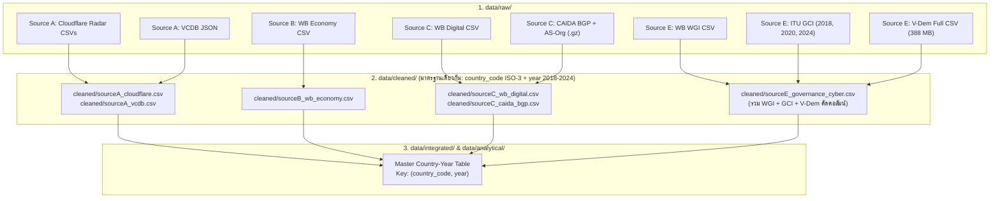

# รายงานการตรวจสอบข้อมูลใน `data/raw` และแผนการทำ Data Cleaning (Source A–E)

เอกสารนี้สรุปผลการตรวจสอบไฟล์จริงทั้งหมดในโฟลเดอร์ `data/raw/` (ขนาดข้อมูล, โครงสร้างคอลัมน์, ช่วงปี, จำนวนประเทศ, ค่าว่าง และจุดผิดปกติที่ตรวจพบ) พร้อมแนวทางการทำ **Data Cleaning (`data/cleaned/`)** เพื่อเตรียมเข้าสู่ขั้นตอน Integration ระดับ **`(country_code, year)`**

---

## ภาพรวมสถานะข้อมูลใน `data/raw/`

| Source | หมวดหมู่ข้อมูล | ไฟล์ใน `data/raw/` | ช่วงปีที่มี | จำนวนแถว | สถานะ |
|---|---|---|---|---|---|
| **Source A (1)** | Cloudflare Radar (DDoS & Traffic) | `sourceA/cloudeflare_rader/*.csv` (3 ไฟล์) | 2022–2024 | 759 / 600 / 40,386 | มีข้อมูลแล้ว (พบจุดต้องซ่อม 3 จุด) |
| **Source A (2)** | VERIS Community Database (VCDB) | `sourceA/VCDB/data/joined/vcdb_1-of-1.json` | 1971–2026 (ใช้ 2018–2024) | 10,047 เหตุการณ์ (1,869 ในปี 2018–2024) | พร้อมสกัดและยุบรวมรายประเทศ-ปี |
| **Source B** | เศรษฐกิจมหภาค (World Bank WDI) | `sourceB/world_bank_econ_pred.csv` | 2018–2024 | 1,827 แถว (261 รหัส) | พร้อมใช้ (ต้องกรองรหัสภูมิภาคออก) |
| **Source C (1)** | โครงสร้างพื้นฐานดิจิทัล (World Bank WDI) | `sourceC/world_bank_digi_found.csv` | 2018–2024 | 1,827 แถว (261 รหัส) | พร้อมใช้ (ต้องกรองรหัสภูมิภาคออก) |
| **Source C (2)** | โครงข่ายอินเทอร์เน็ต BGP & IPv4/ASN (CAIDA) | `sourceC/BGP/*.pfx2as.gz` (7 ไฟล์) `sourceC/ip24prefix/*.as-org2info.txt.gz` (7 ไฟล์) | 2018–2024 (รายปี ก.ค.) | ~6.3 ล้านแถว (BGP) ~1.3 ล้านแถว (AS-Org) | พร้อมแปลงและคำนวณระดับประเทศ-ปี |
| **Source D** | (โฟลเดอร์ว่าง) | `sourceD/` | - | 0 ไฟล์ | ยังไม่มีไฟล์ในโฟลเดอร์นี้ |
| **Source E (1)** | ธรรมาภิบาล (World Bank WGI) | `sourceE/world_bank_gov_wgi.csv` | 2018–2024 | 1,827 แถว (261 รหัส) | พร้อมใช้ (ต้องกรองรหัสภูมิภาคออก) |
| **Source E (2)** | ITU Global Cybersecurity Index (GCI) | `sourceE/GCI_2018_Raw.csv` `sourceE/GCI_2020_Raw.csv` `sourceE/GCI_2024_Raw.csv` | 2018, 2020, 2024 | 193 / 194 / 176 แถว | โครงสร้างและสเกลคะแนนต่างกันทั้ง 3 ปี |
| **Source E (3)** | สถาบันและธรรมาภิบาลไซเบอร์ (V-Dem v16) | `sourceE/V-Dem-CY-Full+Others-v16.csv` | 1789–2025 (ใช้ 2018–2024) | 28,092 แถว × 4,618 คอลัมน์ | พร้อมคัดกรองเฉพาะปีและตัวแปรที่ต้องการ |

---

## รายละเอียดเจาะลึกและวิธี Clean ข้อมูลราย Source

### 1. Source A: ข้อมูลภัยคุกคามและการโจมตีทางไซเบอร์

#### 1.1 Cloudflare Radar (`data/raw/sourceA/cloudeflare_rader/`)
มี 3 ไฟล์ ได้แก่:
1. [cloudflare_radar_source_a.csv](file:///home/sutthinun/src/causes-of-cyberattacks/data/raw/sourceA/cloudeflare_rader/cloudflare_radar_source_a.csv) — **759 แถว × 21 คอลัมน์** (253 พื้นที่ × 3 ปี: 2022–2024)
2. [cloudflare_attack_flow_pairs.csv](file:///home/sutthinun/src/causes-of-cyberattacks/data/raw/sourceA/cloudeflare_rader/cloudflare_attack_flow_pairs.csv) — **600 แถว × 11 คอลัมน์** (Top 200 คู่ประเทศโจมตี × 3 ปี)
3. [cloudflare_timeseries_weekly.csv](file:///home/sutthinun/src/causes-of-cyberattacks/data/raw/sourceA/cloudeflare_rader/cloudflare_timeseries_weekly.csv) — **40,386 แถว × 6 คอลัมน์** (อนุกรมเวลารายสัปดาห์ของทุกประเทศและ Global)

> [!WARNING]
> **ประเด็นสำคัญทางระเบียบวิธีวิจัย (Methodological Fixes) และจุดที่แก้ไขแล้วใน `Cloudflare_Radar_SourceA.py`:**
> 1. **แยกนิยาม "DDoS" ออกจาก "L7 Mitigated Share รวมทุกกลไก" (ปัญหาข้อที่ 1):**
>    - ข้อมูล `attacks/layer7/top/locations/{target,origin}` แบบไม่กรองคือคำขอที่ถูกบล็อกทั้งหมด (`target_l7_mitigated_percent`, `origin_l7_mitigated_percent`) ซึ่งรวมทั้ง WAF, DDoS, Bot Management, IP Reputation, Access Rules ฯลฯ
>    - ในสคริปต์ล่าสุดจึงดึง **ทั้ง 2 รูปแบบควบคู่กัน**:
>      - `target_ddos_percent` และ `origin_ddos_percent` (กรองพารามิเตอร์ `mitigationProduct=DDOS` เฉพาะ DDoS จริง)
>      - `target_l7_mitigated_percent` และ `origin_l7_mitigated_percent` (ไม่กรอง = ภาพรวมการโจมตีระดับ Layer 7 ทั้งหมด)
>    - ใช้ระบบ Adaptive `limit` (`200 -> 100`) ป้องกันปัญหาส่ง `limit=250` แล้วติด HTTP 400
> 2. **การจัดการข้อมูลสัดส่วนเทียบทั้งโลก — Compositional Data (ปัญหาข้อที่ 2):**
>    - เนื่องจากผลรวมทุกประเทศเท่ากับ 100% จึงไม่สามารถตีความค่าดิบข้ามปีได้โดยตรงว่า "การโจมตีเพิ่มขึ้น"
>    - สคริปต์จะคำนวณดัชนีความเข้มข้นและอัตราส่วนลอการิทึมให้อัตโนมัติ:
>      - **เกณฑ์ขั้นต่ำของทราฟฟิก (`is_above_min_traffic`):** กำหนด `http_traffic_percent >= 0.01%` เพื่อตัดความผันผวนรุนแรงจากประเทศ/เกาะขนาดเล็กที่มีตัวหารใกล้ศูนย์
>      - **Intensity Index:** $\text{Intensity} = \frac{\text{attack\_share\_percent}}{\text{http\_traffic\_percent}}$ (คำนวณเฉพาะประเทศที่ผ่านเกณฑ์ `http_traffic_percent >= 0.01%`)
>      - **Log-Ratio:** $\ln\left(\frac{\text{attack\_share\_percent} + 10^{-4}}{\text{http\_traffic\_percent} + 10^{-4}}\right)$ เพื่อให้การกระจายตัวสมมาตรและเหมาะกับการสร้างโมเดลทางสถิติ
> 3. **ช่วงเวลาของข้อมูลและการบันทึก `meta.dateRange` (ปัญหาข้อที่ 3):**
>    - เนื่องจาก Cloudflare Radar 2.0 เปิดตัวเมื่อ 30 กันยายน 2022 ข้อมูลจาก Radar จึงกำหนดกรอบวิเคราะห์ชัดเจนที่ **ปี 2022–2024 (3 ปี)** และบันทึก `meta_date_start` / `meta_date_end` จาก `result.meta.dateRange` ของ API ลงในตารางทุกแถว พร้อมระบุเป็นข้อจำกัด (Limitation) ของงานวิจัย
> 4. **การดึง Outage Annotations สำหรับ Data Quality Report และข้อจำกัดในการตีความ:**
>    - เพิ่มการดึง `annotations/outages` บันทึกลงไฟล์ `cloudflare_annotations_outages.csv` เพื่อใช้มาร์กช่วงเวลาที่เกิดเหตุขัดข้องของเครือข่ายใน DQ Report
>    - ซ่อมคอลัมน์ `l3_syn_percent`, `l3_udp_percent` (จาก `"SYN Flood"`, `"UDP Flood"`) และแก้รหัสประเทศกรีซ (`GR` $\rightarrow$ `GRC`) รวมถึงตัดรหัสภูมิภาค `AP` และ `EU` ออกเรียบร้อยแล้ว
>    - **ข้อจำกัดที่ต้องระบุในรายงาน (Limitations):**
>      - *Customer Base Bias:* สะท้อนเฉพาะเครือข่ายที่ใช้บริการ Cloudflare
>      - *Mitigation Product Share:* สัดส่วน `mitigation_waf_percent` / `ddos` / `bot` สะท้อนทั้งพฤติกรรมผู้โจมตีและการตั้งค่าไฟร์วอลล์ของลูกค้า Cloudflare
>      - *Layer 3 Origin Spoofing:* ข้อมูล `l3_vector_type` ใช้สำหรับสำรวจ (EDA) เท่านั้น เนื่องจาก IP ต้นทางระดับ Layer 3 สามารถปลอมแปลง (IP Spoofing) ได้ง่าย

#### 1.2 VERIS Community Database — VCDB (`data/raw/sourceA/VCDB/`)
- ไฟล์หลักที่ใช้คือ [vcdb_1-of-1.json](file:///home/sutthinun/src/causes-of-cyberattacks/data/raw/sourceA/VCDB/data/joined/vcdb_1-of-1.json) (รวมทุก incident ไว้ในไฟล์เดียวแล้ว 10,047 รายการ)
- ในช่วงปี **2018–2024** มีเหตุการณ์ที่มีระบุประเทศผู้เสียหาย (`victim.country`) จำนวน **1,869 เหตุการณ์** ใน **68 ประเทศ** (กระจุกตัวที่สหรัฐฯ `US` 1,401 เหตุการณ์ รองลงมาคือ `GB` 60, `IN` 54, `CA` 49)
- **วิธี Clean:**
  1. กรองเฉพาะ `timeline.incident.year` ระหว่าง `2018–2024`
  2. ดึงรหัสประเทศจาก `victim.country` (เป็น ISO-2) แล้วแปลงเป็น ISO-3 (`country_code`) โดยตัดรายการที่เป็น `"Unknown"` ออก
  3. ยุบรวม (Aggregate) เป็นระดับ `(country_code, year)` เช่น `vcdb_incident_count`, จำนวนแยกตามประเภทการโจมตี (`action.hacking`, `action.malware`, `action.social`, `action.error`)
  4. หมายเหตุ: เนื่องจาก VCDB มีอคติการรายงาน (Reporting Bias) สูงในประเทศที่ใช้ภาษาอังกฤษ (โดยเฉพาะ `USA`) จึงเหมาะใช้เป็นข้อมูลเสริมใน EDA หรือต้อง Normalize ด้วยขนาดเศรษฐกิจ/ประชากร

---

### 2. Source B: ปัจจัยเศรษฐกิจมหภาค (`data/raw/sourceB/`)
- **ไฟล์:** [world_bank_econ_pred.csv](file:///home/sutthinun/src/causes-of-cyberattacks/data/raw/sourceB/world_bank_econ_pred.csv) (**1,827 แถว × 7 คอลัมน์**, ปี 2018–2024, 261 รหัส `country_code`)
- **ค่าว่าง (Missing Values):**
  - `population`: 0 แถว (ครบ 100%)
  - `secure_internet_servers_per_1m`: ว่าง 20 แถว (1.1%)
  - `gdp_per_capita`: ว่าง 64 แถว (3.5%)
  - `fdi_net_inflows`: ว่าง 153 แถว (8.4%)
- **วิธี Clean:**
  1. **ตัดรหัสกลุ่มภูมิภาคและกลุ่มรายได้ของ World Bank ออก (~45 รหัส):** เช่น `AFE` (Africa Eastern and Southern), `WLD` (World), `HIC` (High income), `EUU` (European Union), `OED` (OECD members) โดยเก็บไว้เฉพาะประเทศจริงตามมาตรฐาน ISO-3 (~215–217 ประเทศ)
  2. **จัดการค่าว่าง (Imputation):** ใช้การเติมค่าภายในประเทศเดียวกันตามลำดับเวลา (`Linear Interpolation` หรือ `Forward Fill / Backward Fill` แยกตาม `country_code`) สำหรับประเทศที่ขาดข้อมูลบางปี (เช่น ปี 2024 ที่บางประเทศยังรายงานไม่ครบ)
  3. **การปรับการกระจายตัว (Transformation):** ตัวแปร `gdp_per_capita`, `secure_internet_servers_per_1m`, และ `population` มีความเบ้ขวาสูงมาก (Right-skewed) ควรสร้างคอลัมน์ `log1p(...)` เพิ่มในขั้น Transform/Feature Engineering

---

### 3. Source C: โครงสร้างพื้นฐานดิจิทัลและโครงข่ายอินเทอร์เน็ต (`data/raw/sourceC/`)

#### 3.1 World Bank Digital Foundation (`sourceC/world_bank_digi_found.csv`)
- **ไฟล์:** [world_bank_digi_found.csv](file:///home/sutthinun/src/causes-of-cyberattacks/data/raw/sourceC/world_bank_digi_found.csv) (**1,827 แถว × 5 คอลัมน์**, ปี 2018–2024)
- **ค่าว่าง:** `internet_users_pct` ว่าง 351 แถว (ส่วนใหญ่เป็นปี 2024 ที่ ITU/World Bank ยังไม่อัปเดตครบทุกประเทศ), `broadband_subs_per_100` ว่าง 237 แถว
- **วิธี Clean:**
  1. ตัดรหัสกลุ่มภูมิภาคของ World Bank ออกเหมือน Source B
  2. ใช้ `Groupby(country_code)` ทำ **Linear Interpolation + Forward Fill (`ffill`)** เพื่อเติมค่าปี 2023–2024 จากแนวโน้มของปีก่อนหน้าในประเทศเดียวกัน
  3. ตรวจสอบขอบเขตค่า (Range check): `internet_users_pct` ต้องอยู่ในช่วง `[0, 100]`

#### 3.2 CAIDA RouteViews BGP & AS-to-Organization (`sourceC/BGP/` และ `sourceC/ip24prefix/`)
- **ไฟล์ข้อมูล (ครบทั้ง 7 ปี: 2018–2024):**
  - `sourceC/BGP/routeviews-rv2-YYYY0701-*.pfx2as.gz`: ตั้งแต่ 768,259 แถว (ปี 2018) ถึง 1,002,405 แถว (ปี 2024)
  - `sourceC/ip24prefix/YYYY0701.as-org2info.txt.gz`: มี 2 ตารางในไฟล์เดียว คือ ตารางองค์กร (`org_id -> country` ~71k–95k แถว) และตาราง ASN (`aut -> org_id` ~86k–117k แถว)
- **วิธี Clean และ Aggregate (ด้วย PySpark / Pandas):**
  1. **แตกตาราง `as-org2info` ของแต่ละปี:** แยกส่วน `# format:org_id|...` และ `# format:aut|...` แล้ว Join กันด้วย `org_id` เพื่อได้ตาราง mapping **`asn -> country_iso2`** ของแต่ละปี
  2. **ทำความสะอาดหมายเลข ASN ในไฟล์ `pfx2as`:**
     - ในข้อมูล BGP บางแถวมี Multi-origin AS (MOAS) เช่น `13335_15169` หรือ AS Set เช่น `1234,5678` $\rightarrow$ ให้แยกเอา ASN ตัวแรก (Primary Origin ASN) และแปลงเป็นจำนวนเต็ม (`int`)
     - กรองเฉพาะ IPv4 prefixes ที่มี `prefix_length` ระหว่าง `8` ถึง `24`
  3. **คำนวณจำนวน `/24` IPv4 Blocks ( menghindariปัญหาการนับซ้ำจาก Sub-prefix / De-aggregation):**
     - แต่ละ prefix ความยาว $L$ (เมื่อ $L \le 24$) มีขนาดเทียบเท่ากับ $2^{(24 - L)}$ บล็อกของ `/24` (เช่น `/16` = $2^8 = 256$ บล็อก `/24`, `/24` = $1$ บล็อก `/24`)
  4. **Join `pfx2as` เข้ากับ `asn -> country` แล้ว Groupby `(country_code, year)`** เพื่อสร้างตัวแปรระดับประเทศ-ปี:
     - `active_asn_count`: จำนวนเครือข่าย ASN ที่มีการประกาศเส้นทางจริงในประเทศนั้น
     - `bgp_prefix_count`: จำนวน IP Prefixes ทั้งหมดที่ประกาศ
     - `ipv4_slash24_count`: จำนวนบล็อก `/24` ทั้งหมดของประเทศ (และคำนวณเป็นจำนวน IP = `ipv4_slash24_count * 256`)

---

### 4. Source D (`data/raw/sourceD/`)
- ปัจจุบันโฟลเดอร์ `data/raw/sourceD/` **ยังว่างอยู่** (0 ไฟล์)
- หากทีมตัดสินใจรวมตัวแปรไว้ใน Source A, B, C, E ครบ 5 มิติแล้ว (เพราะใน `sourceC` มีทั้ง World Bank Digital + CAIDA BGP และใน `sourceE` มีทั้ง WGI + GCI + V-Dem) สามารถจัดหมวดหมู่ใหม่ให้ salah หนึ่งเป็น Source D (เช่น แยก CAIDA BGP/IP Exposure เป็น Source D และ World Bank Digital เป็น Source C) เพื่อให้ครบ A–E ตามโครงสร้างใน `README.md` ได้ทันที

---

### 5. Source E: ธรรมาภิบาลและศักยภาพความมั่นคงปลอดภัยไซเบอร์ (`data/raw/sourceE/`)

#### 5.1 ITU Global Cybersecurity Index (`GCI_2018_Raw.csv`, `GCI_2020_Raw.csv`, `GCI_2024_Raw.csv`)
> [!IMPORTANT]
> **ความแตกต่างสำคัญของไฟล์ GCI ทั้ง 3 ปี ที่ต้องปรับมาตรฐาน (Standardize) ตอน Clean:**
> - **[GCI_2018_Raw.csv](file:///home/sutthinun/src/causes-of-cyberattacks/data/raw/sourceE/GCI_2018_Raw.csv) (193 แถว):**
>   - คอลัมน์: `['country_name', 'country_code', 'gci_score', 'gci_global_rank', 'year']`
>   - `country_code` เป็น **ISO-2** (เช่น `GB`, `US` และนามิเบีย `NA` กลายเป็น `NaN` 1 แถว)
>   - **`gci_score` อยู่ในสเกล `0.000 – 1.000`** (เช่น UK = `0.931`)
> - **[GCI_2020_Raw.csv](file:///home/sutthinun/src/causes-of-cyberattacks/data/raw/sourceE/GCI_2020_Raw.csv) (194 แถว):**
>   - คอลัมน์: `['Country Name', 'Score', 'Rank']` (ไม่มีคอลัมน์ `year` และไม่มี `country_code`)
>   - ชื่อประเทศมีอักขระพิเศษปน เช่น `'United States of America**'`, `'Iran (Islamic Republic of)'`
>   - **`Score` อยู่ในสเกล `0 – 100`** (เช่น US = `100.0`, UK = `99.54`)
> - **[GCI_2024_Raw.csv](file:///home/sutthinun/src/causes-of-cyberattacks/data/raw/sourceE/GCI_2024_Raw.csv) (176 แถว):**
>   - คอลัมน์: `['Country Name', 'Legal Measures', 'Technical Measures', 'Organizational Measures', 'Capacity Development Measures', 'Cooperation Measures', 'Tier']`
>   - ไม่มีคอลัมน์ `gci_score` รวม (ต้องนำคะแนนทั้ง 5 เสาหลักซึ่งเต็มเสาละ 20 คะแนน **มารวมกันเป็นคะแนนเต็ม 100**: `gci_score = Legal + Technical + Organizational + Capacity + Cooperation`) และไม่มี `country_code` / `year`

- **วิธี Clean ข้อมูล GCI:**
  1. **ปรับสเกลคะแนนให้อยู่ในช่วง `0 – 100` เหมือนกันทั้งหมด:**
     - ปี 2018: คูณ `gci_score` ด้วย `100` (`0.931` $\rightarrow$ `93.1`)
     - ปี 2020: ใช้ `Score` เดิม (`0 – 100`)
     - ปี 2024: คำนวณ `gci_score = Legal Measures + Technical Measures + Organizational Measures + Capacity Development Measures + Cooperation Measures` (`0 – 100`)
  2. **ทำความสะอาดชื่อประเทศและแปลงเป็น `country_code` (ISO-3):** ลบเครื่องหมาย `*` ท้ายชื่อประเทศในไฟล์ปี 2020 แล้วแมปชื่อประเทศเป็นรหัส ISO-3 มาตรฐานเดียวกัน
  3. **เติมข้อมูลปีที่ไม่ได้จัดทำรายงาน (2019, 2021, 2022, 2023):** เนื่องจาก ITU จัดทำ GCI ไม่ทุกปี จึงควรทำ **Step Interpolation / Forward Fill** (หรือ Linear Interpolation ระหว่าง `2018 -> 2020 -> 2024`) เพื่อให้สามารถ Join กับตาราง Country-Year ปี 2018–2024 ได้โดยข้อมูลไม่แหว่งหาย

#### 5.2 World Bank WGI (`sourceE/world_bank_gov_wgi.csv`)
- **ไฟล์:** [world_bank_gov_wgi.csv](file:///home/sutthinun/src/causes-of-cyberattacks/data/raw/sourceE/world_bank_gov_wgi.csv) (**1,827 แถว × 5 คอลัมน์**, ปี 2018–2024)
- มีคอลัมน์ `gov_effectiveness` และ `rule_of_law` (สเกลประมาณ `-2.5` ถึง `+2.5`)
- **วิธี Clean:** กรองรหัสภูมิภาคของ World Bank ออก และเติมค่าว่างรายประเทศด้วย `Interpolation / ffill` เหมือน Source B

#### 5.3 V-Dem Dataset v16 (`sourceE/V-Dem-CY-Full+Others-v16.csv`)
- **ไฟล์:** [V-Dem-CY-Full+Others-v16.csv](file:///home/sutthinun/src/causes-of-cyberattacks/data/raw/sourceE/V-Dem-CY-Full+Others-v16.csv) (**28,092 แถว × 4,618 คอลัมน์**, ขนาด 388 MB)
- **วิธี Clean:**
  1. **คัดเฉพาะแถวในปี `2018 <= year <= 2024`** (จะลดจาก 28,092 แถว เหลือเพียง **1,253 แถว** จาก 179 ประเทศ)
  2. **คัดเฉพาะคอลัมน์ที่ใช้จริง (ไม่เกิน 10–15 คอลัมน์):**
     - Join Keys: `country_text_id` (เปลี่ยนชื่อเป็น `country_code` ซึ่งเป็น ISO-3 อยู่แล้ว), `country_name`, `year`
     - ตัวแปรหลักด้านประชาธิปไตย/สถาบัน: เช่น `v2x_polyarchy` (Electoral democracy index), `v2x_libdem` (Liberal democracy index), `v2x_rule` (Rule of law index)
     - ตัวแปรด้านไซเบอร์และสังคมดิจิทัล (Digital Society Survey — `v2sm*`):
       - `v2smgovcapsec`: ศักยภาพด้านความมั่นคงปลอดภัยไซเบอร์ของรัฐบาล (Government cyber security capacity)
       - `v2smgovfilprc`: การกรอง/บล็อกเนื้อหาอินเทอร์เน็ตโดยรัฐในทางปฏิบัติ (Government internet filtering in practice)
       - `v2smgovshut`: การตัดสัญญาณอินเทอร์เน็ตโดยรัฐ (Government internet shut down in practice)
       - `v2smgovsmmon`: การสอดส่องดูแลโซเชียลมีเดียโดยรัฐ (Government social media monitoring)
       - `v2smfordom`: การแทรกแซง/เผยแพร่ข้อมูลเท็จจากต่างชาติผ่านระบบออนไลน์ (Foreign governments dissemination of false information)
       - `v2smpolcap`: ขีดความสามารถด้านความมั่นคงปลอดภัยไซเบอร์ของพรรคการเมืองหลัก (Political parties cyber security capacity — V-Dem codebook v16 หัวข้อ 7.2.10)

---

## สรุปลำดับขั้นตอนการลงมือทำ Data Cleaning แนะนำ (`data/cleaned/`)

### สิ่งที่แนะนำให้ทำเป็นอันดับแรกก่อนเริ่มเขียน Pipeline Cleaning:
1. **ซ่อมคอลัมน์ใน `cloudflare_radar_source_a.csv` (ใช้เวลา ~5 วินาที):** ดึงเฉพาะ `target_ddos_percent` และ `origin_ddos_percent` (ด้วย `limit=100`) และแกะค่า `l3_syn_percent` / `l3_udp_percent` จาก `l3_vector_breakdown_json` รวมถึงแก้รหัสประเทศกรีซ (`GR` $\rightarrow$ `GRC`)
2. **สร้างตาราง Master Country Reference (`ISO-3`, `ISO-2`, `country_name`):** เพื่อใช้กรองเอาเฉพาะประเทศจริง (~215 ประเทศ) และตัดแถวที่เป็นภูมิภาค (`AFE`, `WLD`, `EU`, `AP`) ออกให้ตรงกันทุก Source
3. **เขียนสคริปต์ Cleaning แยกตาม Source ลง `src/cyber_pipeline/cleaning/`** เพื่อส่งออกไฟล์ที่สะอาดแล้วไปไว้ใน `data/cleaned/`
