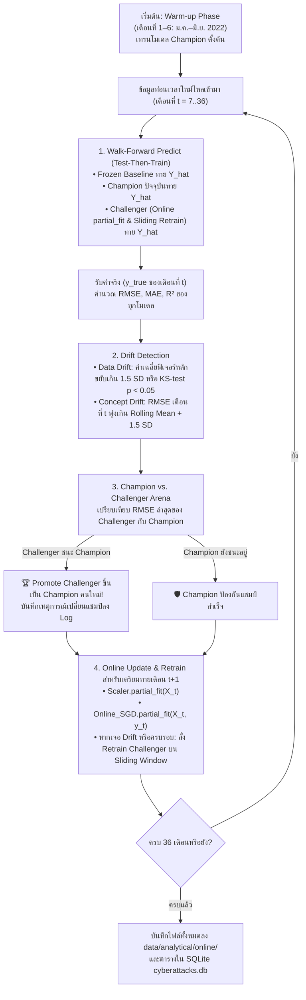
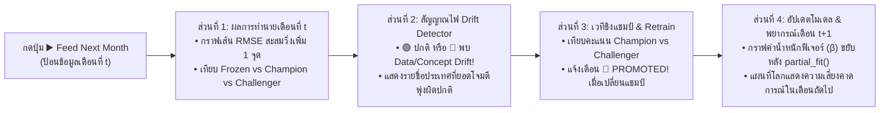

# แผนการพัฒนาระบบ Online Machine Learning (`docs/online_ml_plan.md`)

เอกสารนี้สรุปแผนการออกแบบและพัฒนาระบบ **Online Machine Learning (Online ML)** สำหรับโปรเจกต์วิเคราะห์สาเหตุและการพยากรณ์การโจมตีทางไซเบอร์ โดยออกแบบให้สอดคล้องกับ **เกณฑ์การประเมินรายวิชา Data Engineering / Data Science (DE/DS)** และข้อเสนอแนะของอาจารย์ผู้สอนครบทุกประเด็น

---

## 1. กรอบแนวคิดตามเกณฑ์ประเมินของอาจารย์ (Course Rubric Alignment)

จากข้อเสนอแนะของอาจารย์ ระบบ Online ML ในโปรเจกต์นี้ถูกออกแบบให้ตอบโจทย์ 5 ประเด็นหลักดังนี้:

| ประเด็นจากอาจารย์ | แนวทางที่เราจะทำในโปรเจกต์นี้ | เหตุผลสนับสนุน (Justification) |
| :--- | :--- | :--- |
| **1. องค์ประกอบหลัก 4 ส่วน** (`Walk-Forward`, `ตรวจ Drift`, `Retrain`, `Champion/Challenger`) | สร้างระบบจำลองครบทั้ง 4 กลไกในสคริปต์เดียว (`src/analysis/online_ml.py`) พร้อมบันทึก Log การทำงานทุกขั้นตอนลง `data/analytical/online/` และฐานข้อมูล SQLite | ตรงตามเกณฑ์การประเมิน (Grading Rubric) ของรายวิชา 100% และสามารถเปิดตาราง/กราฟโชว์การสลับตำแหน่งแชมป์และจุดที่เกิด Drift ได้ชัดเจน |
| **2. การจำลองข้อมูลย้อนหลัง (Historical Replay Simulation)** | ใช้หลักการ **Test-Then-Train (Prequential Evaluation)** สมมติเวลาเริ่มต้นที่ครึ่งแรกของปี 2022 แล้วไหลข้อมูลเข้าทีละท่อนเวลา (ทำนายก่อน $\rightarrow$ รับค่าจริง `y_true` $\rightarrow$ วัดผล/ตรวจ Drift $\rightarrow$ อัปเดตโมเดล) | อาจารย์ยืนยันว่าการใช้ Historical Replay ตามลำดับเวลาโดยทำนายก่อนแล้วค่อยรับ Label มาอัปเดตโมเดลเป็นมาตรฐานที่ยอมรับได้และใช้กันจริงในอุตสาหกรรม |
| **3. การหั่นท่อนเวลาให้เห็นฤดูกาลครบ $\ge 2$ รอบปี** | หั่นข้อมูลออกเป็น **รายเดือน (36 ท่อนเวลา: ม.ค. 2022 – ธ.ค. 2024 = ครบ 3 รอบปีเต็ม)** ควบคู่กับ **รายปี (3 ท่อนเวลา: 2022 $\rightarrow$ 2023 $\rightarrow$ 2024)** | แก้ปัญหาข้อมูลสั้นเกินไปจนไม่เห็นฤดูกาล (Seasonality) เพราะข้อมูล 36 เดือนของเราครอบคลุมถึง **3 รอบปีเต็ม** (มากกว่าเกณฑ์ขั้นต่ำ 2 รอบปีที่อาจารย์ระบุ) |
| **4. การใช้ `.partial_fit()` ร่วมกับระบบชิงแชมป์** | ใช้โมเดลตระกูล True Online Linear (`SGDRegressor(loss="huber")` ที่มี `.partial_fit()` แท้) เป็นหนึ่งในผู้ท้าชิง (`Challenger`) แข่งกับโมเดลแชมป์ปัจจุบัน (`Champion`) และโมเดล Retrain บนหน้าต่างข้อมูลล่าสุด | ได้ใช้ทั้ง `.partial_fit()` ตามทฤษฎี Online Learning แท้ๆ และมีระบบ `Champion vs. Challenger` คอยคัดกรองไม่ให้โมเดลที่เพิ่งอัปเดตทำงานแย่ลงกว่าเดิม |
| **5. ความคุ้มค่าของการใช้ Airflow vs. Python Scheduler** | • **งาน Data Pipeline ต้นน้ำ (5 แหล่งข้อมูล A–E):** ใช้ Airflow DAG (`dags/cyber_pipeline_dag.py`) • **งาน Online ML Replay ปลายน้ำ:** รันเป็น Lightweight Python Engine ที่เรียกต่อท้าย DAG หรือรันผ่าน CLI ได้ทันที | ตรงตามหลัก Engineering Trade-off ที่อาจารย์เน้นย้ำ: ใช้ Airflow เฉพาะจุดที่ต้องป้องกันงานแซงกัน (รอ Clean 5 แหล่งเสร็จก่อน Join และเบรกทันทีถ้าไม่ผ่าน DQ Check) แต่ไม่ตั้ง Airflow ปลุก Container ถี่ๆ เกินความจำเป็นในขั้น Replay |

---

## 2. การเตรียมข้อมูลและการหั่นท่อนเวลา (Time-Slicing & Data Construction)

เพื่อให้ระบบ Online ML ทั้ง **เปรียบเทียบข้ามประเทศได้จริง** และ **มีจำนวนท่อนเวลามากพอที่จะเห็น Seasonality & Drift ครบ 3 รอบปี (2022–2024)** เราจะสร้างชุดข้อมูล Online ML เป็น **2 ระดับ** ดังนี้:

### 2.1 ระดับหลัก: ข้อมูลรายเดือน 36 ท่อนเวลา (Monthly Replay Panel: 36 เดือน × 144 ประเทศ = 5,184 แถว)
* **ที่มาของข้อมูล:** ผสานตารางฟีเจอร์โครงสร้างระดับประเทศ-ปีจาก [data/analytical/v2/features.csv](file:///home/sutthinun/src/causes-of-cyberattacks/data/analytical/v2/features.csv) เข้ากับอนุกรมเวลารายสัปดาห์จาก [data/cleaned/cloudflare_timeseries_weekly.csv](file:///home/sutthinun/src/causes-of-cyberattacks/data/cleaned/cloudflare_timeseries_weekly.csv) (40,386 แถว)
* **วิธีแก้ปัญหาสเกล `trend_scaled` เพื่อให้เปรียบเทียบข้ามประเทศได้:**
  1. ยุบรวมค่า `trend_scaled` รายสัปดาห์ของแต่ละประเทศให้เป็นค่าเฉลี่ยรายเดือน ($m = 1 \dots 12$ ในแต่ละปี) และปรับสเกลให้ค่าเฉลี่ยทั้งปีของประเทศนั้นเท่ากับ `1.0`:
     $$w_{i, y, m} = \frac{\text{mean\_trend}_{i, y, m}}{\frac{1}{12}\sum_{k=1}^{12} \text{mean\_trend}_{i, y, k}}$$
  2. นำตัวคูณความผันผวนรายเดือน $\ln(w_{i, y, m})$ ไปบวกเข้ากับค่าความเข้มข้นรายปีของประเทศนั้น (`attack_intensity_floored_log`, `origin_ddos_intensity_log`, `origin_l7_intensity_log`):
     $$Y_{i, y, m} = Y_{i, y}^{\text{(yearly\_log)}} + \ln(w_{i, y, m} + 10^{-4})$$
  * **ข้อดีของสูตรนี้:** ค่าเฉลี่ยทั้ง 12 เดือนของประเทศ $i$ ในปี $y$ จะเท่ากับระดับความเข้มข้นจริงของประเทศนั้นในตาราง V2 (เปรียบเทียบข้ามประเทศได้ 100%) ในขณะที่แต่ละเดือนจะสะท้อนการพุ่งขึ้นหรือลดลงตามฤดูกาลและเหตุการณ์โจมตีจริงจาก Cloudflare Time-Series!
* **ฟีเจอร์ที่ใช้ในแต่ละเดือน ($t = 1 \dots 36$):**
  1. **ฟีเจอร์โครงสร้างพื้นฐาน เศรษฐกิจ และธรรมาภิบาล 25 ตัวจาก V2 (`ALL_FEATURES_V2_Z`)**
  2. **ฟีเจอร์อนุกรมเวลาและฤดูกาล (Temporal & Seasonal Features — คำนวณจากอดีตล้วนๆ ไม่รั่วไหลจากอนาคต):**
     * `lag1_y`: ความเข้มข้นของการโจมตีในเดือนก่อนหน้า ($t-1$)
     * `lag2_y`: ความเข้มข้นของการโจมตีเมื่อ 2 เดือนก่อน ($t-2$)
     * `rolling_3m_mean_y`: ค่าเฉลี่ยเคลื่อนที่ย้อนหลัง 3 เดือน ($t-3 \dots t-1$)
     * `rolling_3m_std_y`: ความผันผวน (SD) ย้อนหลัง 3 เดือน
     * `month_sin`, `month_cos`: ตัวแปรวัฏจักรฤดูกาลรายปี ($\sin(2\pi m / 12)$, $\cos(2\pi m / 12)$)

### 2.2 ระดับเปรียบเทียบ: ข้อมูลรายปี 3 ท่อนเวลา (Yearly Macro Walk-Forward: `2022 → 2023 → 2024`)
* ใช้ตาราง [data/analytical/v2/features.csv](file:///home/sutthinun/src/causes-of-cyberattacks/data/analytical/v2/features.csv) (432 แถว) รันแบบ Walk-Forward รายปี (เริ่มเทรนปี 2022 $\rightarrow$ ทายและอัปเดตปี 2023 $\rightarrow$ ทายและอัปเดตปี 2024) เพื่อใช้เปรียบเทียบค่า `test_2024_r2` และ `test_2024_rmse` กับโมเดล Batch ML ใน `data/analytical/v2/model_metrics.csv` ได้โดยตรง

---

## 3. รายละเอียดการทำงานของ 4 กลไกหลักใน `src/analysis/online_ml.py`

### รายละเอียดของแต่ละกลไกในโค้ด:

1. **โมเดลที่ใช้แข่งขันในระบบ (4 บทบาท):**
   * 🧊 **`1_Frozen_Baseline` (โมเดลแช่แข็ง):** เทรนเฉพาะช่วง Warm-up (6 เดือนแรกของปี 2022) แล้ว **ไม่เคยอัปเดตอีกเลยตลอด 3 ปี** (มีไว้เป็นตัวเปรียบเทียบให้เห็นว่าถ้าไม่ทำ Online ML ความแม่นยำจะเสื่อมลงอย่างไรเมื่อเวลาผ่านไป)
   * ⚡ **`2_Challenger_Online_SGD` (True Online Learning — `.partial_fit()`):** ใช้ `StandardScaler().partial_fit()` คู่กับ `SGDRegressor(loss="huber", penalty="l2")` เรียก `.partial_fit()` อัปเดตค่าน้ำหนัก ($\beta$) ทุกๆ เดือนที่มีข้อมูลใหม่เข้ามา
   * 🔄 **`3_Challenger_Sliding_Retrain` (Window Retrain Model):** โมเดลเส้นตรง/Ensemble ที่ทำการ Retrain ใหม่บนหน้าต่างข้อมูลล่าสุด (Sliding Window 12 เดือนล่าสุด = 1 รอบปี) เมื่อระบบตรวจพบ Drift หรือครบรอบการอัปเดต
   * 🏆 **`4_Active_Champion` (โมเดลแชมป์ที่ระบบเลือกใช้งานจริงในเดือนนั้น):** เริ่มต้นจากโมเดล Warm-up และจะถูกแทนที่ด้วย `Challenger` ตัวที่ทำผลงานดีกว่าตามกฎการชิงแชมป์

2. **เกณฑ์การตรวจจับ Drift (`Drift Detection Rules`):**
   * **Data Drift (`data_drift_flag`):** ตรวจสอบการเปลี่ยนแปลงของการกระจายตัวของฟีเจอร์ในเดือนที่ $t$ เทียบกับหน้าต่างอ้างอิงก่อนหน้า (ใช้ Two-sample Kolmogorov-Smirnov Test หรือค่า $|\Delta \mu| / \sigma_{\text{ref}} > 1.5$)
   * **Concept / Performance Drift (`concept_drift_flag`):** ตรวจสอบความคลาดเคลื่อน `RMSE` ของโมเดลแชมป์ในเดือนที่ $t$ หากพุ่งสูงกว่าค่าเฉลี่ยเคลื่อนที่ย้อนหลังเกินเกณฑ์ ($\text{RMSE}_t > \text{RollingMean}(\text{RMSE}) + 1.5 \times \text{RollingStd}(\text{RMSE})$) ระบบจะยกธงเตือน `drift_detected = True` และบังคับสั่ง Retrain ทันที

3. **กติกาการชิงแชมป์ (`Champion vs. Challenger Promotion Rule`):**
   * ในแต่ละท่อนเวลา $t$ ก่อนที่จะอัปเดตข้อมูลเดือนที่ $t$ เข้าโมเดล ระบบจะวัดค่าความผิดพลาด (`RMSE` และค่าเฉลี่ยเคลื่อนที่ 2 เดือนล่าสุดเพื่อป้องกันความฟลุก) ของ `Champion` เทียบกับ `Challenger` ทั้งสองตัว
   * ถ้า `Challenger` ตัวใดมีค่า Error ต่ำกว่า `Champion` ปัจจุบัน (ชนะเกินเกณฑ์ขั้นต่ำ `margin = 1%`) ระบบจะสั่ง **Promote** ผู้ท้าชิงตัวนั้นขึ้นเป็น `Champion` สำหรับใช้ทำนายในเดือน $t+1$ ทันที!

---

## 4. รายชื่อไฟล์ผลลัพธ์ที่จะสร้างใน `data/analytical/online/`

เมื่อรันสคริปต์ `PYTHONPATH=src .venv/bin/python -m analysis.online_ml` ระบบจะสร้างไฟล์ผลลัพธ์ 5 ไฟล์ลงในโฟลเดอร์ `data/analytical/online/` (และบันทึกลง SQLite `data/warehouse/cyberattacks.db`) ดังนี้:

| ชื่อไฟล์ใน `data/analytical/online/` | จำนวนแถวโดยประมาณ | คำอธิบายและคอลัมน์สำคัญในไฟล์ |
| :--- | :---: | :--- |
| **1. `online_metrics_summary.csv`** | ~24 แถว | **ตารางสรุปคะแนนรวมตลอดการจำลอง** เปรียบเทียบทั้ง 3 งาน (`Target_DDoS`, `Origin_DDoS`, `Origin_L7`) ระหว่าง `Frozen_Baseline`, `Online_PartialFit_SGD`, `Sliding_Retrain_Ridge`, และ `Champion_Challenger_System` (มีคอลัมน์ `overall_r2`, `overall_rmse`, `overall_mae`, `n_drift_events`, `n_promotions`) |
| **2. `online_replay_log.csv`** | ~90–108 แถว *(30 เดือน Replay × 3 งาน)* | **ตารางบันทึกเหตุการณ์รายเดือน (Time-Step Log)** มีคอลัมน์: `task_name`, `year_month`, `step_idx`, `frozen_rmse`, `online_sgd_rmse`, `retrain_rmse`, `champion_rmse`, `data_drift_detected`, `concept_drift_detected`, `retrain_triggered`, `champion_before`, `champion_after`, `promoted` (`True/False`) |
| **3. `online_drift_events.csv`** | เฉพาะเดือนที่เกิด Drift | **ตารางเจาะลึกเหตุการณ์ Drift** บอกว่าเดือนไหนเกิด Drift ชนิดใด ฟีเจอร์ตัวไหนหรือประเทศไหนที่เป็นต้นเหตุให้ค่า Error พุ่ง (เช่น เดือนที่การโจมตีในยุโรปตะวันออกหรือตะวันออกกลางพุ่งสูง) และการ Retrain ช่วยกด Error ในเดือนถัดมาลงได้เท่าไหร่ |
| **4. `online_coef_evolution.csv`** | ~750–900 แถว | **ตารางการเปลี่ยนแปลงค่าน้ำหนักฟีเจอร์ ($\beta$) ตามเวลา** ของโมเดล `Online_PartialFit_SGD` ในแต่ละเดือน เพื่อใช้พล็อตกราฟโชว์ว่าเมื่อเวลาผ่านไปตั้งแต่ปี 2022 ถึง 2024 ฟีเจอร์ไหนมีความสำคัญเพิ่มขึ้นหรือลดลง |
| **5. `online_predictions.csv`** | ~12,960 แถว | **ตารางผลทำนายรายประเทศในแต่ละท่อนเวลา** (`iso3`, `country_name`, `year_month`, `y_true`, `y_pred_frozen`, `y_pred_online_sgd`, `y_pred_champion`, `residual_champion`) |

---

## 5. แผนการทำ Interactive Visualization แบบกดดูทีละเดือน (Step-by-Step Monthly Replay Simulator)

เพื่อให้ตอนนำเสนอโปรเจกต์ (Live Demo ตามข้อ 11–12 ใน `docs/architecture.md`) สามารถโชว์การทำงานของระบบ Online ML ให้เห็นภาพเคลื่อนไหวแบบ **"เมื่อเทรนเสร็จแล้วป้อนข้อมูลเดือนถัดไปเข้ามา จะเกิดอะไรขึ้นต่อไปทีละก้าว"** เราจะออกแบบหน้าจอ **Interactive Online ML Simulator** (ด้วย **Streamlit + Plotly** ที่มีอยู่ใน `requirements.txt` แล้ว) โดยแบ่งเป็น 4 ส่วนหลักดังนี้:

### 5.1 แผงควบคุมการไหลของเวลา (Time-Step Replay Controller)
ผู้ใช้หรืออาจารย์สามารถกดปุ่มควบคุมเวลาเพื่อจำลองการไหลของข้อมูลทีละเดือนตั้งแต่มกราคม 2022 ถึงธันวาคม 2024 (36 เดือน):
* ⏮️ **`Reset to Warm-up (มิ.ย. 2022)`**: รีเซ็ตระบบกลับไปจุดเริ่มต้นหลังเทรนโมเดลแชมป์ตัวแรกเสร็จ (เดือนที่ 1–6)
* ▶️ **`Feed Next Month (+1 เดือน)`**: กดเพื่อปล่อยข้อมูลของเดือนถัดไป ($t \rightarrow t+1$) เข้าระบบทีละเดือน
* ⏩ **`Auto-Play Replay`**: ให้ระบบไหลข้อมูลเข้าทีละเดือนอัตโนมัติพร้อมแอนิเมชันกราฟวิ่งตามเวลา
* 🎚️ **`Month Slider (เดือนที่ 7 ถึง 36)`**: เลื่อนดูสถานะของระบบในเดือนใดก็ได้ทันที

### 5.2 หน้าจอแสดงผล 4 เหตุการณ์ที่จะเกิดขึ้นทันทีเมื่อกดปุ่ม "▶️ เดือนถัดไป"
ทุกครั้งที่กดปุ่มป้อนข้อมูลเดือนใหม่ ($t$) หน้าจอจะอัปเดต 4 กล่องข้อมูลพร้อมกัน:

1. **ส่วนที่ 1 — กราฟเส้นเปรียบเทียบความคลาดเคลื่อนตามเวลา (Live Performance Curve):**
   * กราฟเส้น Plotly แสดงค่า `RMSE` และ `R²` รายเดือนตั้งแต่เดือนที่ 7 จนถึงเดือนปัจจุบันที่กดเลือก
   * เห็นเส้น **`Frozen_Baseline` (สีเทาประ)** ค่อยๆ ทายเพี้ยนหนักขึ้นเมื่อเวลาผ่านไป ในขณะที่เส้น **`Online_SGD (.partial_fit)` (สีฟ้า)** และ **`Active_Champion` (สีเขียวหนา)** ปรับตัวกดความคลาดเคลื่อนลงได้ตลอด 3 รอบปี
2. **ส่วนที่ 2 — สัญญาณไฟตรวจจับ Drift รายเดือน (Real-Time Drift Radar 🚦):**
   * แสดงสถานะของเดือนปัจจุบันว่า **🟢 Normal (ข้อมูลปกติ)** หรือ **🔴 Drift Alert (ตรวจพบการเปลี่ยนแปลงฉับพลัน)**
   * พร้อมกราฟแสดงค่า `Drift Score` เทียบกับเส้นเพดานเตือนภัย (Threshold) และบอกทันทีว่าในเดือนนั้นประเทศไหนที่เป็นตัวการทำให้เกิด Drift (เช่น เดือนที่เกิดการโจมตีพุ่งสูงในยุโรปตะวันออกหรือตะวันออกกลาง)
3. **ส่วนที่ 3 — เวทีชิงแชมป์ (Champion vs. Challenger Scoreboard 🏆 vs 🥊):**
   * แสดงการ์ดเปรียบเทียบตัวต่อตัวในเดือนนั้นว่า **`Champion` (แชมป์ปัจจุบัน)** ทำ `RMSE` ได้เท่าไหร่ vs **`Challenger_Online_SGD` (`.partial_fit()`)** และ **`Challenger_Sliding_Retrain`** ทำได้เท่าไหร่
   * ถ้าเดือนนั้นผู้ท้าชิงชนะ จะแสดงป้ายแจ้งเตือน **"🎉 PROMOTION: เลื่อนขั้น Challenger ขึ้นเป็น Champion คนใหม่สำหรับเดือนถัดไป!"**
4. **ส่วนที่ 4 — สิ่งที่เกิดขึ้นหลังโมเดลเรียนข้อมูลเดือนนี้เสร็จ (`What Happens Next: Month t+1 Forecast`):**
   * **กราฟค่าน้ำหนักฟีเจอร์ ($\beta$) ขยับตัว:** แสดงให้เห็นว่าหลังจากเรียก `.partial_fit()` ด้วยข้อมูลเดือนที่ $t$ แล้ว โมเดลปรับเพิ่มหรือลดความสำคัญของฟีเจอร์ตัวไหนบ้าง
   * **แผนที่โลกและตารางพยากรณ์ล่วงหน้าของเดือนถัดไป ($t+1$):** ใช้โมเดลแชมป์ตัวล่าสุดที่เพิ่งอัปเดตเสร็จ ทายล่วงหน้าทันทีว่าใน **เดือนถัดไป ($t+1$)** ประเทศไหนจะมีความเสี่ยงถูกโจมตีสูงสุด/ต่ำสุด (และพอกดปุ่ม `▶️ Feed Next Month` อีกครั้ง ก็จะเห็นทันทีว่าที่โมเดลทายล่วงหน้าไว้เมื่อกี้ ตรงกับความจริงของเดือนถัดไปแค่ไหน!)

### 5.3 โหมดทดลองป้อนข้อมูลจำลองเอง (Interactive "What-If" Next-Month Simulator)
นอกจากกดดูข้อมูลจริงตามลำดับเดือนที่ 7–36 แล้ว จะมีแท็บพิเศษ **"🧪 ทดลองป้อนข้อมูลเดือนอนาคต (What-If Simulation)"**:
* ให้ผู้ใช้ลองใช้ Slider ปรับสถานการณ์ของเดือนถัดไปเองได้ (เช่น ลองจำลองว่า *"ถ้าเดือนหน้าทราฟฟิกบอทเน็ตพุ่งขึ้น +2 SD หรือเกิดความขัดแย้งทางไซเบอร์เพิ่มขึ้น"* แล้วกดปุ่ม **"Feed to Online Model"**)
* หน้าจอจะคำนวณสดๆ ทันทีว่า: ระบบจะยกธงเตือน Drift ไหม? โมเดล `.partial_fit()` จะขยับเส้นพยากรณ์และค่าน้ำหนักฟีเจอร์ ($\beta$) ไปทางไหน? และใครจะชนะได้เป็น Champion?

---

## 6. ขั้นตอนการดำเนินงาน (Implementation Steps)

1. **ขั้นที่ 1 — สร้างสคริปต์ `src/analysis/online_ml.py` และสร้างข้อมูลลง `data/analytical/online/`:**
   * สร้างตาราง Monthly Replay Panel (36 เดือน × 144 ประเทศ) จาก `data/analytical/v2/features.csv` + `data/cleaned/cloudflare_timeseries_weekly.csv`
   * รัน `OnlineChampionChallengerEngine` ครบทั้ง 4 กลไก (`Walk-Forward Predict`, `Drift Detector`, `Incremental partial_fit & Sliding Retrain`, `Champion-Challenger Promoter`)
   * บันทึกไฟล์ผลลัพธ์ทั้ง 5 ไฟล์ลง `data/analytical/online/` และตารางใน SQLite (`data/warehouse/cyberattacks.db`) เพื่อให้หน้า Visualization ดึงไปแสดงผลได้ทันทีและยังสามารถรัน `.partial_fit()` สดๆ บนหน้าเว็บได้ด้วย
2. **ขั้นที่ 2 — สร้างแอปพลิเคชัน Visualization (`src/analysis/online_ml_dashboard.py`):**
   * พัฒนาหน้า Interactive Dashboard ด้วย **Streamlit + Plotly** ที่มีปุ่มกดเลื่อนดูทีละเดือน (`▶️ Next Month`), กราฟเปรียบเทียบโมเดล, ไฟแจ้งเตือน Drift, เวที Champion vs. Challenger, แผนที่โลกพยากรณ์เดือนถัดไป และโหมดทดลองป้อนข้อมูลใหม่ (What-If Simulator)
3. **ขั้นที่ 3 — ทดสอบรันและสรุปผลการทดลอง:**
   * ตรวจสอบความถูกต้องของข้อมูลทุกตารางใน `data/analytical/online/` และวิธีเปิดใช้งานหน้า Dashboard สำหรับทำ Live Demo

